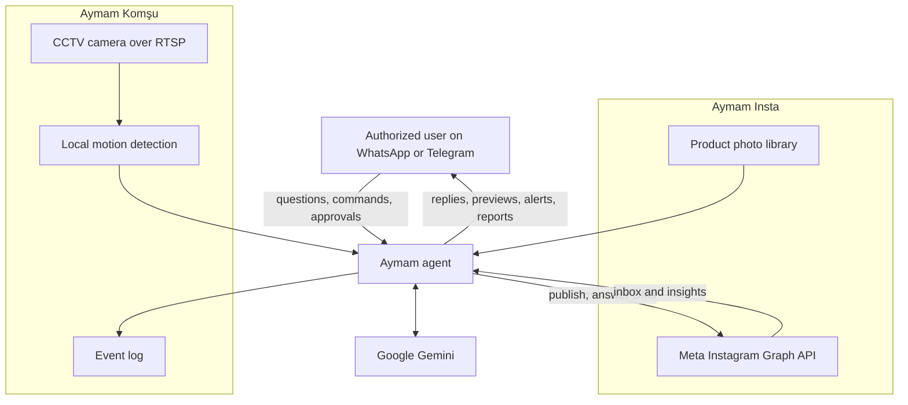

# Hey you 🫵

Hope you find something useful in my page for your work.

I'm Fatih. I design, build, and run [aymam.ai](https://aymam.ai) — AI agents that you manage from WhatsApp and Telegram, the apps you already use, rather than from a new dashboard.

## aymam.ai

Aymam AI is a founder-led company in Istanbul. Two agents are available today.

### Aymam Insta

An Instagram assistant steered from WhatsApp or Telegram.

It plans posts, Reels, and daily stories from a shop's product photo library, generates images and short videos, publishes them on a schedule, and replies to customer DMs using only the shop's own product information. Messages it is unsure about are handed back to the owner. A morning preview and a weekly report arrive in the chat; anything can be cancelled, or held until the owner approves it.

The product site is [insta.aymam.ai](https://insta.aymam.ai).

### Aymam Komşu

A camera assistant that turns an ordinary CCTV feed into something you can talk to on WhatsApp, Telegram, or the web.

It keeps a plain-language log of what happens, answers questions such as “what happened in the last hour?”, and can watch for conditions you describe in your own words — for example, “tell me if the minibus arrives.” Alerts can include a photo. It is instructed not to identify people or read licence plates.

The public source and a live demo are in [komsu](https://github.com/mfatihdincx/komsu) and at [komsu.aymam.ai](https://komsu.aymam.ai).

## How the agents are put together

The idea is the same for both products: the messaging app is the control surface. Only numbers you authorize can give orders.

A bit more detail, only where it is public:

- Language, vision, image and video generation, and draft replies all go through **Google Gemini**.
- Insta talks to Instagram through **Meta's official Instagram Graph API**. Both agents use the **WhatsApp Business Platform**; Komşu also uses the **Telegram Bot API**, plus a small web app for live view and chat.
- Komşu pulls frames from the camera with **ffmpeg**, runs **motion detection on the server** so only useful frames are sent to the model, and in one structured Gemini call writes a short scene description and checks danger and watch conditions. The public repo is **Node.js and Express**.
- Servers are in the EU, on **AWS in Frankfurt**.
- The services are written with KVKK and GDPR in mind: commands only from authorized numbers, optional approval before anything is published, and camera descriptions that stay general.

The agents work in Turkish, English, and Russian.

## Other things I've built

- [komsu](https://github.com/mfatihdincx/komsu) — the camera agent above, also published as an open-source demo
- [davud-telegram-bot](https://github.com/mfatihdincx/davud-telegram-bot) — a small Telegram companion bot (Gemini + Open-Meteo), built for a kids' agent-building lesson
- [trStr-PyPI-package](https://github.com/mfatihdincx/trStr-PyPI-package) — a Python package for Turkish character conversion
- [staticscoach](https://github.com/mfatihdincx/staticscoach) — study material for engineering statics, with some AI help
- A few Streamlit apps: [a book list](https://github.com/mfatihdincx/streamlit_booksaver), a [credit-default](https://github.com/mfatihdincx/streamlit_defaultPredictor) toy model, and a [lung-cancer](https://github.com/mfatihdincx/streamlit_cancer) toy model

## Contact

[aymam.ai](https://aymam.ai) · [mfatihdinc.com](https://mfatihdinc.com) · fatih@aymam.ai
